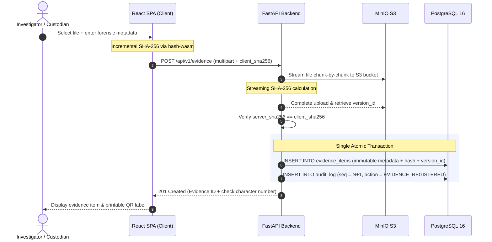
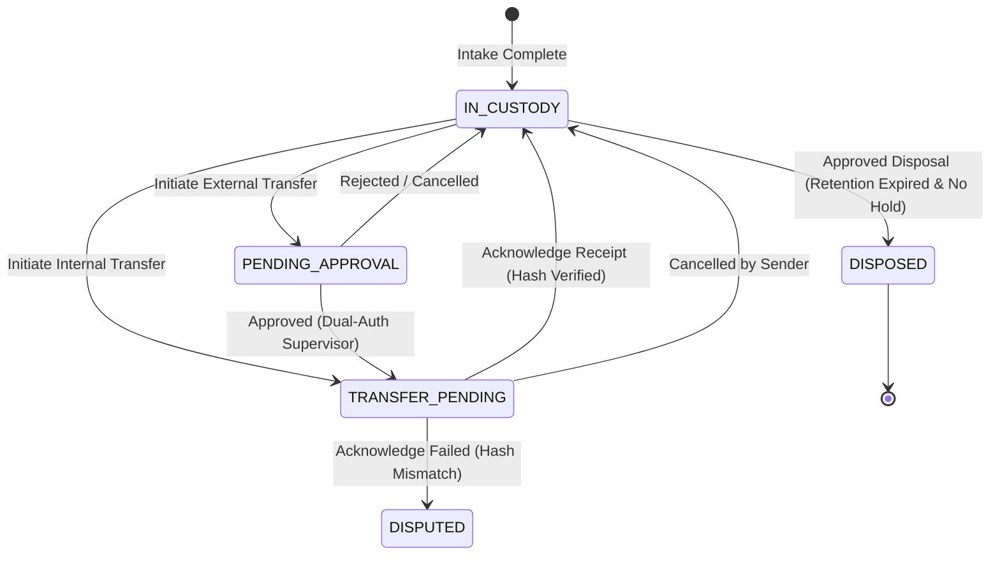
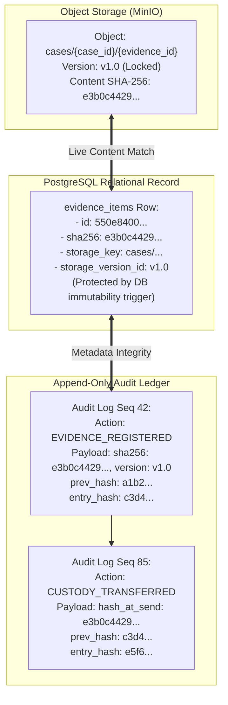
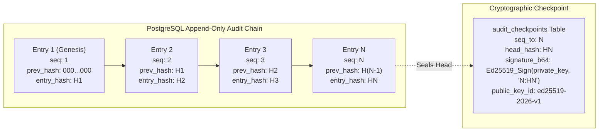

# SealTrail Architecture & Trust Model

## 1. System Overview

SealTrail ensures the non-repudiation, tamper-evidence, and courtroom defensibility of digital evidence using a layered defense-in-depth model across the application, database, and storage subsystems.

---

## 2. Infrastructure & Container Topology

```mermaid
flowchart TD
    Browser["Analyst Workstation (Browser)"]
    
    subgraph Host ["Docker Host Environment"]
        Nginx["nginx :8080 (Reverse Proxy & Static SPA)"]
        Backend["backend :8000 (FastAPI + APScheduler)"]
        Postgres[("PostgreSQL 16 :5432 (App & Owner Roles)")]
        MinIO[("MinIO S3 :9000/:9001 (Versioned Storage)")]
    end

    Browser -->|HTTP/HTTPS :8080| Nginx
    Nginx -->|/api/*| Backend
    Nginx -->|Static Assets| Nginx
    Backend -->|SQL (app_user)| Postgres
    Backend -->|boto3 S3 API| MinIO
```

### Trust Boundaries & Network Isolation
- **Perimeter (Public)**: Nginx reverse-proxy on port `8080` terminates requests, enforces Content-Security-Policy, strips server headers, and serves the pre-compiled Vite SPA bundle.
- **Internal Network**: Communication between FastAPI, PostgreSQL, and MinIO occurs within an isolated Docker bridge network.
- **Database Roles**: The FastAPI application connects using the least-privilege `app_user` role. DDL modifications and schema migrations run strictly as `owner_user` during container boot.
- **Storage Policies**: MinIO IAM policies explicitly deny `s3:DeleteObject` and `s3:DeleteObjectVersion` to the `sealtrail-app` credential. Disposal operations utilize a separate single-purpose privileged credential.

---

## 3. Evidence Ingestion Pipeline



---

## 4. Custody Transfer State Machine

Evidence custody transitions are enforced by a strict state machine that guarantees accountability:



### State Transition Rules
1. **Initiation**: When a custodian initiates a transfer, `hash_at_send` is recorded from the live object and status transitions to `TRANSFER_PENDING`.
2. **Two-Person Rule for External Transfers**: Transfers to third-party entities require prior approval from a supervisor who is not the requester (`decided_by <> requested_by`).
3. **Receipt Acknowledgement**: The receiving custodian confirms receipt by submitting `hash_at_receipt`. The system matches this against `hash_at_send`. If identical, custody changes; if differing, an immediate `CRITICAL` alert is dispatched.
4. **SLA Deadlines**: Transfers have an `ack_due_at` SLA timestamp. An automated background task flags any transfer exceeding its SLA without acknowledgement.

---

## 5. Three-Way Cryptographic Integrity Binding

To prevent silent evidence tampering or decoupling of audit records, SealTrail enforces a three-way cryptographic binding:



### Continuous Verification
- **Automated Evidence Sweep**: Background workers read the live S3 object stream, recompute the SHA-256 digest, verify that the active version matches `storage_version_id`, and compare against `evidence_items.sha256`.
- **Three Failure States**:
  - `OK`: Storage content hash matches the database record.
  - `OBJECT_REPLACED`: The S3 key exists and matches the hash, but its version ID changed.
  - `CORRUPT / HASH_MISMATCH`: The content of the S3 object has changed.

---

## 6. Hash Chain & Ed25519 Checkpoint Structure



### Defense Against Malicious Database Administrators
1. If a rogue administrator updates an audit entry directly in PostgreSQL, the hash chain breaks (`prev_hash != calculated_hash` for subsequent rows).
2. If the rogue administrator recomputes all hashes down the entire chain to forge consistency, the newly calculated head hash will fail verification against the historical **Ed25519-signed checkpoints** published outside the transaction table.
