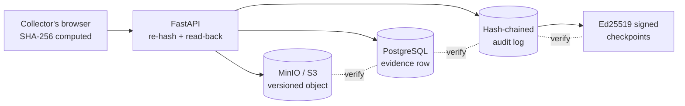

# SealTrail — Pitch Guide for Judges

*Digital Evidence Chain-of-Custody & Case Collaboration · HACKNOVA 2026 · Problem Statement 04*

> Before presenting: the file map in Section 6 follows the planned repository layout. After the build, open `docs/FILE_MAP_ACTUAL.md` and fix any difference. Check the legal sentence in the opening story (marked **[verify]**) against the source one more time.

---

## 1. Open with the story (60–75 seconds)

**Say this, slowly, no slides yet:**

> Let me start with something every one of us has lived through.
>
> It's the night before final-year project submission. Four of us, one pen drive, one presentation. Rahul copies it to his laptop. Sneha "just fixes the fonts." Someone adds a slide at 2 a.m. In the morning, the file on the pen drive is not the one we rehearsed with. Slide 7 is gone. Nobody did it on purpose. And nobody can prove who changed what, or when. We argued for an hour, and we lost marks for it.
>
> Now put one thing on that pen drive: the only copy of a transaction log pulled from a seized phone in a bank-fraud case. Someone's freedom depends on it.
>
> Two months later, in court, the defence lawyer asks one question: *"Who had this between the 3rd and the 19th, and can you prove it hasn't changed by a single byte?"*
>
> If the honest answer is a spreadsheet and a WhatsApp group, the evidence can be challenged. A guilty person walks free, or an innocent person loses their defence.
>
> In India this is now written into law. Since July 2024, Section 63 of the Bharatiya Sakshya Adhiniyam requires a certificate for electronic records that discloses the record's **hash value**, and the Supreme Court has recently upheld that requirement. **[verify]**
>
> We built **SealTrail** so that the answer to the lawyer's question is one click, and the answer is *proof*, not trust.

**Then the one-liner (slide 1):** *SealTrail makes digital evidence prove its own history.*

**The three promises (slide 2):**
1. **Prove it hasn't changed.** Every file is hashed with SHA-256 at intake and re-checked at every handover.
2. **Prove who touched it.** Every view, transfer, annotation and approval goes into a hash-chained, append-only log.
3. **Prove it to someone who doesn't trust us.** Reports and export packages are signed and verifiable offline, without our servers.

---

## 2. The five-minute demo (rehearse this; it is the pitch)

| Time | What you do | What you say |
|---|---|---|
| 0:00 | Log in as **investigator1**. Open **Evidence Items**. | "This is a working case workspace. Every row is real evidence, stored in S3-compatible storage with its SHA-256 recorded." |
| 0:30 | **+ Create Evidence**. Drop a file. Show the progress bar. | "The hash is computed **in the browser first**. The server computes it again and refuses the upload if they differ. Integrity starts on the collector's machine, not ours." |
| 1:00 | Show the result card: evidence number, matched hashes, read-back check. Click **Print Label**. | "A unique ID with a check character, so a mistyped label is caught. The QR opens this item. Reprints are counted and audited." |
| 1:30 | **Actions → Transfer custody** to **investigator2**. | "We re-verify the file on every handover. The transfer is not complete until the receiver acknowledges it." |
| 1:50 | Log in as **investigator2** (second window). **Acknowledge receipt.** | "Receipt is verified again. A mismatch would mark the transfer *disputed* and raise an alert." |
| 2:15 | As **supervisor1**: request an **export package**. Show that **supervisor1 cannot approve it**. Log in as **supervisor2** and approve. | "Sensitive actions need two different people. This is enforced in the service layer **and** by a database constraint, not only in the UI." |
| 2:50 | Open **Audit Log**. Show the chain status banner. Open a row's drawer. | "Each entry contains the hash of the one before it, like a chain. Editing any entry breaks every link after it." |
| 3:15 | **The attack.** In a terminal, run `tamper_demo.py audit --seq N` as a "malicious DBA" who bypasses the database triggers. Click **Verify chain**. | "I am now a database administrator with full rights, and I just edited history." The page turns red and names the exact entry. |
| 3:45 | **The smart attacker.** Run `tamper_demo.py audit-rewrite --from-seq N`, which recomputes a *consistent* chain. Click **Verify chain**. | "A clever attacker rebuilds all the hashes. It still fails, because our checkpoints are signed with a key that is not in the database." |
| 4:10 | Run `tamper_demo.py object --evidence <number>`. Open **Alerts**. | "Someone swapped the file in storage. We detect it, we show the original version is intact, and we raise a critical alert with an explanation." |
| 4:30 | Run `tamper_demo.py restore`. Download the **export package** and run `python verify.py` offline. | "The package verifies on any laptop with no network and no SealTrail. A court expert can check it independently." |
| 4:50 | Close on the Section 63 draft certificate page from the package. | "And it pre-fills the hash value that Indian law now asks for." |

**Rules for the demo:** have two browser windows logged in beforehand; run `tamper_demo.py restore` before you start so the system is green; keep the terminal font large; if anything fails live, say "that's exactly what the alert is for," and move on to the next step.

---

## 3. How the integrity actually works (one slide)

**Three-way binding:** the stored file, the database row and the audit entry all carry the same SHA-256. Changing any one of them is detected by comparing it with the other two.

| Layer | What it stops or detects |
|---|---|
| Browser + server hashing | Corruption or substitution in transit |
| Read-back after upload | Storage failing to store what we sent |
| Versioned bucket, app credentials without delete | The application itself can never delete evidence; an overwritten object leaves the original recoverable |
| Database triggers and grants | The application cannot edit or delete audit rows, even through a bug |
| Hash chain | Editing, deleting or reordering any audit entry |
| Signed checkpoints | A complete, consistent rewrite of the chain by someone with full database rights |
| Dual authorization (service + DB constraint) | One person abusing a sensitive action |
| Separation of duties | The administrator cannot read evidence at all |

---

## 4. Requirement coverage (give this to judges as a handout)

| Requirement from the problem statement | Where in SealTrail | Shown in demo |
|---|---|---|
| Register files and device extracts with source, collector, date, case metadata | Create Evidence flow, `evidence_items` | 0:30 |
| Hashes at ingestion, verified on every transfer | SHA-256 client + server + read-back; re-check on transfer, receipt, download, export | 1:00–2:00 |
| Unique evidence IDs and controlled labels | Check-character IDs, PDF labels with QR, counted reprints | 1:00 |
| Record each transfer, view, export, annotation, acknowledgement | Hash-chained audit log | 2:50 |
| Role-based approvals and dual authorization | RBAC matrix, approval engine with two-person rule | 2:15 |
| Link evidence to people, events, notes, timelines without changing originals | Link tables and case timeline; evidence rows are immutable by trigger | case tour |
| Tamper-evident chronological custody reports | Signed JSON and PDF reports, verifiable later | 4:30 |
| Flag hash mismatches, missing acknowledgements, unusual access | Alert rules with plain-language explanations | 4:10 |
| Legal hold, retention rules, secure export packages | Hold with dual-approved release, retention and approved disposal, signed export with offline verifier | 2:15, 4:30 |

---

## 5. What makes SealTrail different

1. **The tamper demo is real.** Most teams claim tamper-evidence. We attack our own system live, including as a database administrator.
2. **We defeat the clever attacker, not just the careless one.** Signed checkpoints stop a fully recomputed chain.
3. **Verification does not need us.** The export package carries its own verifier, public key and manifest.
4. **Controls live below the UI.** Append-only and two-person rules are enforced by the database, so a bug or a malicious client cannot bypass them.
5. **Built for how Indian courts now work.** The hash value sits at the center of the Section 63 BSA certificate, and we pre-fill a draft of it.
6. **We say what we don't cover.** The threat model has a "not covered" column, because judges trust teams that name their own limits.

---

## 6. What every file does

*(Planned layout; reconcile with `docs/FILE_MAP_ACTUAL.md` after the build.)*

### Root
| File | Purpose |
|---|---|
| `AGENTS.md` | The build specification the AI agent followed; also a readable design document |
| `README.md` | How to run, log in, test and run the tamper demo |
| `docker-compose.yml` | Starts PostgreSQL, MinIO, bucket setup, backend and frontend with one command |
| `.env` / `.env.example` | Configuration and secrets (the real `.env` is never committed) |

### `infra/`
| File | Purpose |
|---|---|
| `postgres/init/01-roles-and-extensions.sh` | Creates the owner role (migrations) and the restricted app role used at runtime |
| `minio/init.sh` | Creates buckets, turns on versioning, creates service users, denies delete for the app user |
| `nginx/nginx.conf` | Serves the React build, proxies `/api`, sets security headers, allows large uploads |

### `backend/app/` core
| File | Purpose |
|---|---|
| `main.py` | Creates the app, wires routers, middleware and the background scheduler |
| `config.py` | Reads settings from the environment and refuses to start if a required one is missing |
| `db.py` | Database sessions using the restricted app role |
| `logging.py`, `errors.py` | Structured logs with request IDs; one consistent error format |
| `deps.py` | Authentication and permission checks used by every route |

### `backend/app/security/`
| File | Purpose |
|---|---|
| `passwords.py` | argon2 hashing and password policy |
| `tokens.py` | Short-lived access tokens and rotating refresh cookies |
| `permissions.py` | The single RBAC matrix: roles, permissions, who can do what |

### `backend/app/models/` and `schemas/`
| Path | Purpose |
|---|---|
| `models/users.py`, `cases.py` | Users, cases, case members |
| `models/evidence.py` | Evidence items (immutable fields protected by a database trigger) |
| `models/custody.py`, `approvals.py` | Transfers and the dual-authorization requests |
| `models/links.py` | People, events, notes, annotations and the links between them |
| `models/audit.py` | The append-only audit log and signed checkpoints |
| `models/alerts.py`, `exports.py` | Alerts and export records |
| `schemas/` | Request and response shapes, validated by Pydantic |

### `backend/app/routers/` (the API)
| File | Purpose |
|---|---|
| `auth.py`, `users.py` | Login, refresh, user management |
| `cases.py` | Cases, members, timeline |
| `evidence.py` | Intake, list, detail, verify, download, labels |
| `custody.py`, `approvals.py` | Transfers, acknowledgements, approve/reject |
| `links.py` | Annotations, people, events, notes, links |
| `audit.py`, `integrity.py` | Read the audit log, verify the chain, run an evidence sweep |
| `alerts.py` | List, acknowledge and resolve alerts |
| `reports.py`, `exports.py` | Custody reports, report verification, export packages |
| `retention.py` | Legal hold, retention policies, disposal |
| `dashboard.py`, `health.py` | Summary numbers; health and readiness checks |

### `backend/app/services/` (the brains)
| File | Purpose |
|---|---|
| `audit_chain.py` | Builds each audit entry, links it to the previous hash, and verifies the whole chain |
| `checkpoints.py` | Signs the chain head with Ed25519 so a full rewrite is detectable |
| `hashing.py` | Chunked SHA-256 for large files |
| `storage.py` | Talks to S3-compatible storage; versions, reads, writes |
| `evidence_ids.py` | Generates evidence numbers with a check character |
| `intake.py` | The registration pipeline: hash, upload, read back, record, audit |
| `integrity.py` | Three-way verification (object, database row, audit entry) |
| `custody.py` | Transfer state machine and acknowledgement rules |
| `approvals.py` | Two-person approval engine |
| `anomaly.py` | Rules that raise explainable alerts |
| `labels.py` | PDF labels with QR codes |
| `custody_report.py` | Signed chronological report in JSON and PDF |
| `export_package.py` | Builds the signed export ZIP with manifest, report and verifier |
| `bsa_certificate.py` | Pre-fills a draft Section 63 BSA certificate |
| `retention.py` | Legal hold, retention checks, approved disposal |
| `jobs/scheduler.py` | Runs periodic jobs: checkpoints, chain checks, overdue acknowledgements, expiry |
| `templates/verify_package.py` | The offline verifier copied into every export as `verify.py` |

### `backend/scripts/` and `tests/`
| File | Purpose |
|---|---|
| `gen_secrets.py` | Generates passwords and the signing key pair into `.env` |
| `seed.py` | Loads synthetic cases and evidence through the real code paths |
| `tamper_demo.py` | The live attack simulator and its `restore` command |
| `tests/` | Proof: chain, database enforcement, tamper detection, RBAC, custody, reports, exports |

### `frontend/src/`
| Path | Purpose |
|---|---|
| `main.tsx`, `App.tsx`, `theme.ts` | Entry point, routes, dark and light themes |
| `api/` | Typed client generated from the backend's OpenAPI file |
| `auth/` | Login state and role-based route guards |
| `layout/` | Sidebar, page header, app shell |
| `components/` | Data table with expandable rows, hash display with copy, status chips, dialogs |
| `lib/` | In-browser SHA-256 hashing, formatters, permission helpers |
| `pages/` | Evidence Items, Cases, Approvals, Transfers, Audit Log, Integrity, Alerts, Reports, Legal Holds, Retention, Users, Dashboard |

### `docs/`
| File | Purpose |
|---|---|
| `ARCHITECTURE.md` | Diagrams and data flow |
| `THREAT_MODEL.md` | Who we defend against, what we stop, what we only detect, what we don't cover |
| `DECISIONS.md`, `KNOWN_LIMITATIONS.md` | Design choices and honest gaps |
| `DEMO_SCRIPT.md`, `QA_CHECKLIST.md` | The rehearsed demo and the manual test record |
| `openapi.json` | The API contract the frontend is generated from |

---

## 7. Questions judges will ask (and honest answers)

**Why not a blockchain?**
A blockchain gives distributed trust between parties who don't know each other. A case workspace has an accountable organization, so what matters is *detecting* tampering and proving it to outsiders. A hash chain plus signed checkpoints gives us that without the cost and privacy problems of publishing evidence metadata on a public ledger. If you need stronger external proof, anchoring checkpoint hashes with a trusted timestamp authority is the next step.

**What if the database administrator is the attacker?**
They can edit rows, and we show that live. The chain breaks. If they recompute the whole chain, the signed checkpoints fail because the signing key is not stored in the database.

**What if they also steal the signing key?**
Then they can forge a consistent history. That is outside what we prevent. The mitigation is external anchoring (a timestamp authority or public anchor) and key storage in an HSM or cloud KMS. It is listed in our limitations.

**Can the application delete evidence?**
No. Its storage credentials have delete denied by policy, and the bucket is versioned. Disposal uses a separate service identity and only runs after dual approval, with no legal hold and an expired retention period. The hash and the audit trail remain forever.

**How do you stop a single rogue supervisor?**
Sensitive actions need two different supervisors. The rule is checked in the service layer and by a database `CHECK` constraint. The administrator role cannot read evidence at all.

**Is the hash computed on the client trustworthy?**
It is a transport check, not the source of truth. The server hashes independently and reads the object back from storage. The client hash lets us prove that what the collector had equals what we stored.

**How does it scale?**
The audit chain is serialized by an advisory lock, which is fine for case-management write rates (not millions per second). Reads, verification and the evidence sweep are streamed. File storage scales with S3. For very large deployments you would shard the chain per case or per tenant and checkpoint each.

**Is this legally valid?**
SealTrail produces the technical proof: hashes, a signed history and a draft Section 63 certificate. The certificate must still be reviewed and signed by the responsible person and an expert, as the law requires. We make no claim of legal advice.

**What about privacy and sensitive evidence?**
Access is need-to-know by case membership, every access is logged, the administrator cannot read evidence, and files never leave through presigned links: everything is served through the API after verification. Encryption at rest and a stronger key-management setup are on the roadmap.

**What did you not finish?**
See `docs/KNOWN_LIMITATIONS.md`. We would rather show a short, true list than a long, vague one.

---

## 8. Honest limitations and roadmap

- No external timestamp anchoring yet (RFC 3161 timestamp authority or public anchor).
- Signing key lives in the environment; production should use an HSM or KMS.
- Single-node deployment and a single audit chain; sharding per case or tenant is the scale path.
- No at-rest encryption of the object store in this prototype.
- Draft certificate only; no e-signature integration.
- Roadmap: hardware-token sign-in, forensic-tool integrations (extraction tools writing straight into SealTrail), mobile scanning of QR labels at the evidence room, and multi-agency case sharing.

---

## 9. Technology stack used and what it does

★ = required by the problem statement (all seven are used).

| Layer | Technology | Used for |
|---|---|---|
| Backend ★ | **FastAPI** (Python 3.12) | The whole REST API, validation, dependency-based permission checks |
| Frontend ★ | **React 18** + TypeScript | The investigator workspace |
| Database ★ | **PostgreSQL 16** | Cases, evidence metadata, custody, approvals, and the audit log, with triggers and grants enforcing append-only |
| Object storage ★ | **MinIO** (S3-compatible, versioned) | Evidence files and export packages; versioning keeps the original recoverable |
| Hashing ★ | **SHA-256** (hashlib in Python, hash-wasm in the browser) | File fingerprints at intake, at every transfer and in reports |
| Audit ★ | **Append-only hash-chained log** | Tamper-evident history; every entry contains the previous entry's hash |
| Access control ★ | **RBAC** (five roles, one permission matrix) | Who can see, move, approve and export; admin separated from evidence |
| ORM and migrations | SQLAlchemy 2.0, Alembic, psycopg 3 | Data access; hand-written migrations that create triggers and grants |
| Validation and settings | Pydantic v2, pydantic-settings | Request/response validation; fail-fast configuration |
| Storage client | boto3 | Upload, read-back, versioning and scoped credentials |
| Authentication | PyJWT, argon2-cffi | Short-lived access tokens, rotating refresh cookies, strong password hashing |
| Signing | `cryptography` (Ed25519) | Signed checkpoints, custody reports and export manifests |
| Documents | reportlab, qrcode, pyzipper | PDF labels and reports, QR codes, AES-256 encrypted ZIP exports |
| Scheduling | APScheduler | Checkpoints, periodic chain verification, overdue-acknowledgement and expiry checks |
| Rate limiting and logs | slowapi, structlog | Login and expensive-endpoint throttling; structured JSON logs with request IDs |
| Testing | pytest, httpx, ruff | Proof that tampering is detected and rules are enforced; lint and format |
| UI toolkit | MUI v5, React Router v6, TanStack Query v5 | Components and theming (dark/light), routing, server-state caching |
| API contract | openapi-typescript, openapi-fetch | Frontend types generated from the backend's OpenAPI file |
| Build tooling | Vite | Fast frontend builds |
| Infrastructure | Docker Compose, nginx | One-command stack; static hosting, reverse proxy, security headers |
| Development | Google Antigravity (agentic IDE) | Built the prototype from the specification in `AGENTS.md` |
